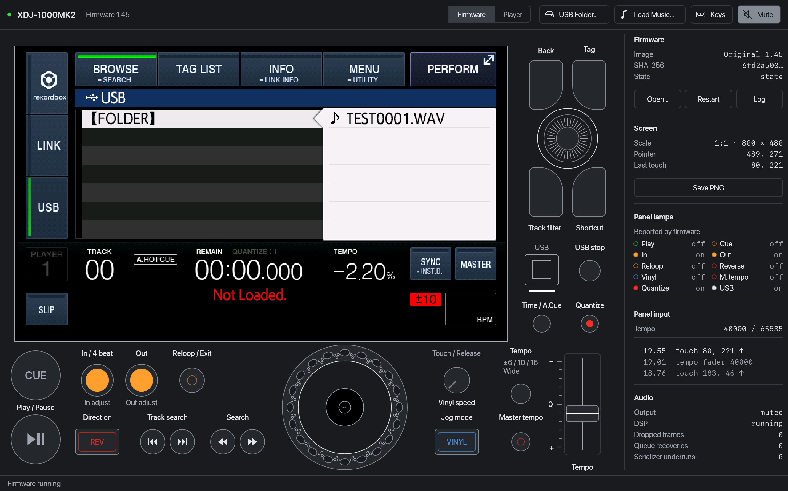
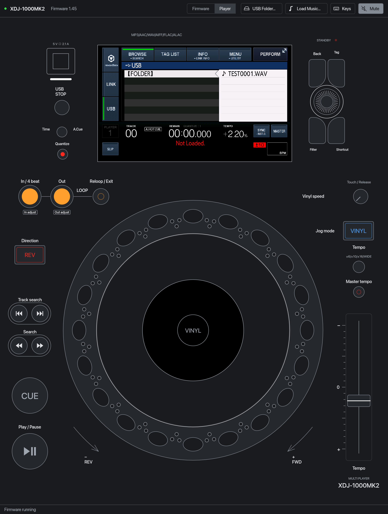

# XDJ-1000MK2 Emulator



*Real emulator capture: firmware 1.45 browsing a synthetic test file. [Screenshot provenance](docs/assets/README.md).*

A native macOS research emulator with a Rust host backend, QEMU SH-4A execution,
a C674x DSP model in C, and a Rust/egui/wgpu desktop UI prototype. Swift emulator sources and comparison tests have been removed; screen OCR calls macOS Vision from Rust. The selected firmware
boots its own MAIN code and draws the player screen. Controls enter through the
modeled panel hardware. No firmware, music, personal settings, or generated
DSP modules are distributed in this repository.

The Rust backend owns firmware validation/import, persistent player instances,
QMP, control input, USB images/overlays, cache identity, preparation, and native
app/engine build orchestration. It replaces the former Python host application.
**Python remains in the retained QEMU build toolchain and C DSP JIT generator.**
An adaptive launch can run that generator. A launch using complete prepared
modules has no Python host backend and does not generate DSP code live.

This is a development emulator. Boot, component tests, and compiler/interpreter
agreement do not establish hardware fidelity, uninterrupted audio, or safe
firmware flashing. The inherited engine still has partial hardware models and
unresolved playback/response acceptance. See [architecture](docs/architecture.md)
and [verification](docs/verification.md).

The [publication checks](docs/publication-validation.md) record 85 passing Rust
tests and outstanding native-suite failures in the current development source.

## Rust desktop UI

<p align="center">
  <a href="docs/assets/player-view.png"></a>
</p>

*Player view from the same emulator session. Click the image for the full-resolution capture.*

Install Rust 1.95 or later. The UI has no Swift/Xcode requirement. Building the
existing QEMU/C engine on macOS still needs its native development toolchain.

```sh
cargo build --locked --release # Rust backend
cargo build --locked --release -p xdj-ui --bin xdj-ui
./target/release/xdj-ui
# Or start with your firmware; audio monitoring starts muted.
./target/release/xdj-ui --firmware /path/to/XDJ1KMK2.UPD
# Backend options go after --.
./target/release/xdj-ui --firmware /path/to/XDJ1KMK2.UPD -- --compile-mode interpreter --audio off
```

The Rust app preserves firmware/player layouts, native panel buttons and lamps,
held keyboard input, touchscreen coordinates, scratch/rim jog input, tempo,
vinyl brake, firmware selection, music/export/image loading, LCD PNG export, restart, playback
validation requests and a bounded event log. It reuses the existing private
JSON bridge and RFB framebuffer. GPU resources are retained and idle windows
repaint on events rather than continuously.

**The UI is portable; the complete player is not yet portable.** The UI builds
independently of the backend and supports local TCP displays on Windows/Linux
and Unix displays on macOS/Linux. The host backend/native engine builder remain
macOS-oriented; Windows process/state ownership, platform audio, native builds,
OCR validation and release packaging still need ports. See
[UI verification and performance](docs/rust-ui.md). Historical UI comparison measurements remain in the evidence documents.

## Build on macOS

Install Xcode command-line tools, Rust/Cargo, Homebrew `pkg-config`, `glib`,
`pixman`, and Python 3 with venv/pip. The full native player currently targets
macOS 13 or later. Rust-only tests also run on Linux.

```sh
cargo build --locked --release
./target/release/xdj-backend build-engine --jobs 6
cargo build --locked --release -p xdj-ui --bin xdj-ui
./target/release/xdj-ui
```

`build-engine` downloads QEMU 9.1.0 from qemu.org, verifies its pinned SHA-256,
applies the maintained patches, builds the DSP shared library and QEMU,
and keeps artifacts under `output/engine/` by default. Use `--out /absolute/build/path`
for a separate build. A successful build atomically records its executable and
matching QEMU data directory in `output/engine.json` for new launches; explicit
`--engine`/`--qemu-data` flags override that selection. Running sessions retain
their existing build. Its Python virtual environment is private to its build directory. To install/open the desktop app, run
`./target/release/xdj-backend build-app --open`. `build-app` bundles the Rust executable in
`~/Applications/XDJ-1000MK2 Emulator.app` with the Rust desktop UI. This is a
repository-based development app; the configured repository and engine paths
must remain available. Portable release packaging is not implemented.

The app has native **File**, **Player**, and **View** menus on macOS and an in-window menu bar on Windows/Linux. **Recent Firmware** remembers up to ten selected source locations. **Archived Firmware** lists locally supplied images in the ignored `firmware/` folder before a player starts.

Local USB defaults can be set in ignored `output/desktop-defaults.json` with
`usb_folder` (the original local USB directory) and `usb_image` (its existing immutable
image). The app attaches that image when a firmware starts. An explicit
`-- --usb-image /path/to/image` overrides it. Paths, USB snapshots and music stay local.

The app starts with an empty player. Choose **Open…** in the firmware
inspector or press **Command/Ctrl+F** to select your own `XDJ1KMK2.UPD`. Audio is muted initially. **Load Music** creates an immutable
FAT32 source image; guest writes go to a private qcow2 overlay. **USB Folder**
preserves rekordbox exports, nested audio, artwork and analysis files. Each
firmware and USB collection gets separate persistent state under `output/`.

```sh
# Validate a supplied image without launching QEMU.
./target/release/xdj-backend inspect --firmware /path/to/XDJ1KMK2.UPD

# Start the app with an explicit image.
./target/release/xdj-backend build-app --open --firmware /path/to/XDJ1KMK2.UPD

# Headless JSON bridge, muted; stdin is newline-delimited JSON.
./target/release/xdj-backend shell --firmware /path/to/XDJ1KMK2.UPD
```

For an existing engine use `--engine /path/to/qemu-system-sh4`,
`--qemu-data /path/to/pc-bios`, and `--python /path/to/python3` as appropriate.
Adaptive compilation still needs this repository's DSP shared library; use
`build-engine` to generate it. `--compile-mode interpreter` avoids live
compilation but can be slower. `--dsp-lag-cap-ms 0` retains all DSP clock debt;
interactive launches default to the existing 300 ms cap. Clock debt forgiven
by that cap cannot qualify real-time accuracy.

## Validation

```sh
cargo fmt --all --check
cargo clippy --locked --workspace --all-targets -- -D warnings
cargo test --locked --workspace
python3 -m unittest discover -s tests/native -v
./target/release/xdj-backend hardware --check-header
```

Tests use synthetic update records and a deliberately limited QMP fixture,
with no firmware downloads. That fixture only tests host behavior; it cannot
establish emulator execution or audio correctness.

Explicit playback validation uses four disposable factory states: adaptive
PCM and MP3 warm-up sessions followed by compiler-free checks of both. Supply a
USB image containing your own MP3 tracks. A PCM tone image is generated locally.
Runs use muted CoreAudio and captured pre-mute PCM, strict clock debt, guest
screenshots, native transport progression, control inputs, and callback/loss
counters. Cancellation never publishes partial preparation. Results stay in
`output/validation-*`; only compatible DSP code is published to player state.

```sh
./target/release/xdj-backend validate \
  --firmware /path/to/XDJ1KMK2.UPD \
  --mp3-image /path/to/your-mp3-usb.img
```

`ready` is a short cache/playback check, not a physical-hardware or ten-minute
qualification. Arbitrary music's PCM check proves nonzero output; tone-mode
phase checks provide stronger continuity evidence. Failed checks remain
`unqualified`; missing host capabilities or cancellation cannot produce
`ready`. Long endurance, broad firmware matrices and control/waveform semantics
remain unverified. Existing cache marker formats are supported, but every
firmware/engine/compiler identity and module file hash is checked.

## Repository and licensing

The repository contains the source required to build the backend and retained
native components. Original firmware and recordings must stay in ignored local
folders. Original Rust backend, desktop UI and catalog code use the
[MIT license](LICENSE-MIT). Native QEMU/DSP components retain their per-file
licenses and the [GPL license text](LICENSE); see [NOTICE](NOTICE.md).
[QEMU documents its licensing here](https://www.qemu.org/docs/master/about/license.html).

This repository was initialized independently from the firmware-modification
project; its Git history contains emulator source, synthetic tests and README visuals.
For GitHub publishing, use [docs/PUBLISHING.md](docs/PUBLISHING.md); it includes
current source changes and artwork while excluding generated caches and state.

An optional local metadata reference can live at
`media/reference/PIONEER/rekordbox/export.pdb`. Reference-media menu items are
shown only when that user-supplied folder exists; its contents remain ignored.
